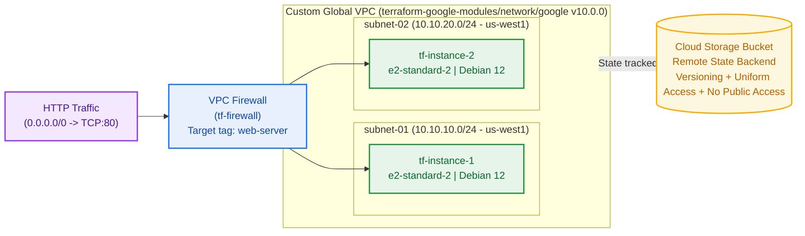

# Modular Google Cloud Infrastructure with Terraform

This repository demonstrates how to provision, import, scale, and manage modular Google Cloud Platform (GCP) infrastructure using **Terraform** (Infrastructure as Code).

## Architecture Overview



## Key Infrastructure & Security Concepts Demonstrated

- **Modular Terraform Architecture:** Cleanly separates compute (`modules/instances`) and storage (`modules/storage`) from the root orchestration layer.
- **Terraform State Import & Lifecycle Management:** Built to support importing pre-existing ("brownfield") Compute Engine VMs into module state, updating machine types in-place (`allow_stopping_for_update`), and cleanly decommissioning unused instances.
- **Hardened Remote State Backend (GCS):** Configures a Google Cloud Storage bucket with **Uniform Bucket-Level Access**, **Public Access Prevention (`enforced`)**, and **Object Versioning** to protect `terraform.tfstate` and enable team collaboration.
- **Terraform Registry Reuse:** Consumes the official [`terraform-google-modules/network/google`](https://registry.terraform.io/modules/terraform-google-modules/network/google/10.0.0) module (`v10.0.0`) to deploy a Global VPC with isolated regional subnets.
- **Least-Privilege Networking:** Scopes `google_compute_firewall` HTTP (`tcp:80`) ingress strictly to VMs carrying the `web-server` network tag, and keeps VMs without external public IPs by default.

## Prerequisites

- [Terraform](https://developer.hashicorp.com/terraform/install) `>= 1.5.7`
- [Google Cloud CLI (`gcloud`)](https://cloud.google.com/sdk/docs/install)
- A Google Cloud Project with the **Compute Engine API** (`compute.googleapis.com`) and **Cloud Storage API** (`storage.googleapis.com`) enabled

## Deployment Instructions

### 1. Authenticate and Configure Variables
```bash
gcloud auth application-default login
cp terraform.tfvars.example terraform.tfvars
# Edit terraform.tfvars with your Project ID and globally unique bucket name
```

### 2. Provision Infrastructure
```bash
terraform fmt -recursive
terraform init
terraform validate
terraform plan
terraform apply
```

### 3. Migrate State to Remote GCS Backend (Optional Post-Bootstrap)
Once `module.storage` has created the GCS bucket:
1. Uncomment the `backend "gcs"` block in `main.tf`.
2. Initialize with your bucket name and confirm state migration (`yes`):
   ```bash
   terraform init -migrate-state -backend-config="bucket=YOUR_STATE_BUCKET_NAME"
   ```

### 4. Importing Existing Compute Instances (Brownfield Pattern)
If `tf-instance-1` or `tf-instance-2` already exist outside Terraform state, import them directly into the `instances` module before running `terraform apply`:
```bash
terraform import module.instances.google_compute_instance.tf_instance_1 \
  projects/YOUR_PROJECT_ID/zones/us-west1-b/instances/tf-instance-1
```

### 5. Clean Up
```bash
terraform destroy
```
